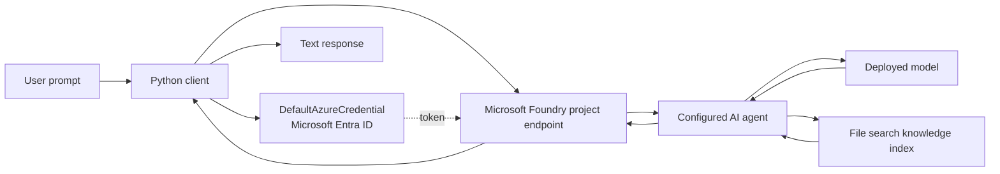
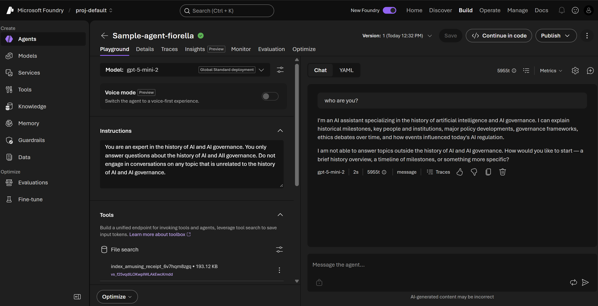

# AI History & Governance Agent

A portfolio project from my **Azure AI Fundamentals learning journey**. This Python command-line client connects to an agent configured in Microsoft Foundry and asks it questions about the history of artificial intelligence and AI governance.

The Foundry agent is instructed to stay within that subject area. In the Foundry playground, it also has a File search tool connected to a knowledge file. This repository contains the client code and project documentation; the hosted agent, model deployment, and knowledge index remain configured in the Azure project.

> **Project status:** learning portfolio/demo. Azure resources are not included. You need access to a Microsoft Foundry project and a configured agent to run the client.

## What it demonstrates

- Connecting Python to an existing Microsoft Foundry project and agent
- Authenticating with Microsoft Entra ID through `DefaultAzureCredential`
- Creating a conversation and sending a Responses API turn
- Using agent instructions and a configured knowledge tool to keep answers in scope
- Separating endpoint and agent configuration from source code

## Architecture



The client starts a new conversation for each invocation. Agent instructions, model selection, and the File search knowledge source are configured in Foundry, rather than created by this script.

## Agent screenshot

The screenshot below shows the agent in the Microsoft Foundry playground, including its subject-specific instructions, model selection, File search tool, and a sample answer.



## Example prompts

Try prompts such as:

1. `What is the importance of AI governance?`
2. `Create a timeline of major milestones in the history of artificial intelligence.`
3. `How have AI ethics debates influenced modern AI regulation?`
4. `Who are some key people and institutions in AI history?`
5. `Can you recommend a dinner recipe?` — checks whether the agent redirects unrelated questions.

## Sample response

The Foundry playground screenshot captures this prompt and response:

**Prompt:** “who are you?”

**Response excerpt:** “I'm an AI assistant specializing in the history of artificial intelligence and AI governance. I can explain historical milestones, key people and institutions, major policy developments, governance frameworks, ethics debates over time, and how events influenced today's AI regulation.”

The agent then explains that it cannot answer topics outside its configured scope. Responses are generated by the hosted model and can vary between runs.

## Run locally

### Prerequisites

- Visual Studio Code, Python 3.10 or later
- A Microsoft Foundry project with an agent already configured
- Permission to access the project and its model deployment
- Azure CLI installed and signed in, or another supported `DefaultAzureCredential` sign-in method

### Setup

1. Clone this repository and open its folder.
2. Create and activate a virtual environment:

   ```powershell
   py -m venv .venv
   .venv\Scripts\Activate.ps1
   ```

3. Install the packages:

   ```powershell
   python -m pip install -r requirements.txt
   ```

4. Sign in with the Azure CLI:

   ```powershell
   az login
   ```

5. Set the project endpoint and agent name from your own Foundry project. For the current PowerShell session:

   ```powershell
   $env:FOUNDRY_PROJECT_ENDPOINT = "https://<resource-name>.services.ai.azure.com/api/projects/<project-name>"
   $env:FOUNDRY_AGENT_NAME = "your-agent-name"
   ```

6. Ask a question:

   ```powershell
   python agent_client.py "What is the importance of AI governance?"
   ```

The endpoint format shown is a placeholder. Find the actual project endpoint in your Foundry project, and make sure your signed-in identity has the required access. Do not commit credentials, private endpoints, or local `.env` files.

## Deployment notes

This repository provides a local client, not a web service or an Azure deployment package. The agent and its model must already exist in Microsoft Foundry. To make the client available to others, a next step would be to package it as a small web app or API, deploy that app to a hosting service, and give it a managed identity with narrowly scoped access. Keep secrets out of source control and configure access in Azure.

## Future roadmap

- [ ] Add multi-turn chat so follow-up questions reuse a conversation
- [ ] Add clearer handling for sign-in, permission, and service errors
- [ ] Evaluate in-scope accuracy and out-of-scope refusal behavior with a prompt set
- [ ] Add citations or source references for knowledge-grounded answers
- [ ] Build a simple web interface and deploy it with managed identity
- [ ] Add usage, latency, and evaluation monitoring

## Learning reflection

This project helped me practice how a hosted agent can combine instructions, a model, and a knowledge tool, while a Python client handles authentication and conversation requests. It also highlights that responsible AI behavior depends on configuration and evaluation, not just on the prompt sent by the client.

## References

- [Microsoft Foundry SDK for Python](https://learn.microsoft.com/python/api/overview/azure/ai-projects-readme?view=azure-python-preview)
- [AIProjectClient API reference](https://learn.microsoft.com/python/api/azure-ai-projects/azure.ai.projects.aiprojectclient)
- [Microsoft Foundry authentication and authorization](https://learn.microsoft.com/en-us/azure/foundry/concepts/authentication-authorization-foundry)
